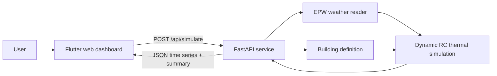

# Application documentation

## Purpose

The Paris Summer Comfort Digital Twin is a local web application for exploring
how envelope performance, south-facing glazing, solar shading, and natural
ventilation affect a dwelling's thermal comfort in a synthetic Paris 2090
climate. It is a comparative design tool, not a replacement for a validated
whole-building energy model.

## Architecture



### Frontend

`frontend/frontend/lib/main.dart` contains the entire current user interface.
It is a two-column Flutter Material dashboard:

- The left panel exposes four sliders and an external-shading switch: wall
  U-value, south window area, overhang depth, maximum natural-ventilation
  air-change rate (ACH), and automatic east/west external solar shading.
- On startup, and after **Run Simulation** is pressed, `runSimulation()` sends
  the slider values as JSON to the API.
- The right panel displays three returned summary values: total cooling,
  hours with operative temperature above 28 °C, and peak operative
  temperature.

The HTTP base URL is hard-coded as `http://127.0.0.1:8000`. Consequently, the
dashboard is intended for local development and the browser must be able to
reach the local FastAPI process. Although the API returns complete hourly time
series, the present UI does not chart them.

### Backend API

`backend/main.py` starts a FastAPI app and permits cross-origin requests during
local development. It exposes:

| Method | Path | Function |
|---|---|---|
| `GET` | `/health` | Returns `{"status":"ok"}`. |
| `POST` | `/api/simulate` | Runs one annual thermal simulation with the submitted parameters. |

The request body is:

```json
{
  "wall_u": 0.25,
  "south_window_area": 10.0,
  "overhang_depth": 0.8,
  "vent_max_ach": 12.0,
  "external_shading_enabled": false,
  "weather_case": "heatwave"
}
```

All fields have the values above as defaults. `weather_case` is interpolated
into the selected EPW filename, so the operational choices are `typical` and
`heatwave`. The service tries `backend/weather/FRA_Paris_2090_<case>.epw`
first and falls back to an equivalent 2050 file if it is missing.

The response contains hourly arrays (`t_out`, `t_air`, `t_op`, `q_cool`, and
`ach_vent`) plus a `summary` object. Cooling values are hourly thermal energy
in Wh; `total_cooling_kwh` sums them and divides by 1,000. Temperature
threshold counts are hourly counts, not sub-hourly duration calculations.

## What happens when a simulation runs

1. The API reads the selected hourly EPW file using `Weather` in
   `backend/building_sim.py`.
2. It creates the default 100 m² one-storey dwelling with `example_house()`.
3. It applies the dashboard values: every wall U-value, the first (south)
   window's area and overhang depth, the ventilation ACH limit, and the
   external-shading switch.
4. `simulate()` advances through 8,760 weather hours, using six implicit
   10-minute time steps per hour.
5. The API serializes selected NumPy arrays to JSON and returns them to the
   browser.

## Thermal model

`backend/building_sim.py` implements a single-zone RC network:

- Air and internal-mass nodes represent the zone.
- Each opaque surface has two thermal mass nodes, giving a 3R2C-style envelope
  treatment with indoor and outdoor film resistances.
- Opaque surfaces use sol-air temperature, combining incident solar radiation
  and a simplified long-wave sky-loss correction.
- Windows receive direct, diffuse, and ground-reflected solar gains. A
  profile-angle calculation shades direct beam radiation when a window has an
  overhang.
- When enabled, external shades on the east and west windows deploy whenever
  the simulated zone-air temperature is above 24 °C. They reduce all solar
  gain components through those windows by 80%; the shade condition is
  reassessed at every 10-minute integration step.
- Infiltration combines a constant ACH and a wind term. Mechanical ventilation
  is optional and includes fan energy.
- Natural ventilation opens when indoor air is near the cooling setpoint and
  outdoor air is sufficiently cooler; stack and wind flow are capped at
  `vent_max_ach`.
- Scheduled people and equipment gains differ for weekdays and weekends.
- Ideal heating and cooling hold their setpoints subject to capacity limits.
  The default house has heating limited to 6 kW and cooling to 5 kW.

Operative temperature is calculated as the average of zone-air temperature and
an area-weighted mean-radiant-temperature approximation. Results should be
read as model outputs based on these assumptions, especially for extreme
weather and natural-ventilation behaviour.

## Weather data

The checked-in EPW files in `backend/weather/` are synthetic Paris-Orly future
years. `backend/weather_gen.py` creates 2050 or 2090 SSP2-4.5 weather files by
starting from a synthetic baseline calibrated to approximate 1991–2020
climatology, applying monthly temperature deltas, and injecting specified heat
wave episodes. It can instead morph a supplied EPW input with
`--from-epw <path>`.

Run it from `backend/` to regenerate its local weather assets:

```powershell
Set-Location backend
python weather_gen.py --year 2090
```

## Running and developing

Requirements already represented in the project are Python with the packages
in `backend/requirements.txt`, plus Flutter. A Python virtual environment is
included under `backend/venv/` in this workspace.

```powershell
# Terminal 1: API
Set-Location backend
.\venv\Scripts\Activate.ps1
uvicorn main:app --reload --port 8000

# Terminal 2: web UI
Set-Location frontend\frontend
flutter pub get
flutter run -d chrome
```

For a production web build, run `flutter build web` in the frontend directory,
then host the generated `build/web` files with a web server. The repository
does not currently configure FastAPI to serve that static build; also change
the frontend's hard-coded API URL for a non-local deployment.

## Offline scenario utilities and outputs

- `run_scenarios.py` defines a larger 150 m² 1980s house plus a deep-insulation
  retrofit. It compares typical and heat-wave years, optional large windows,
  and removal of the overhang. Once its weather path is corrected, it writes
  CSV, Markdown, and PNG results to the root `results/` directory.
- `results/` and `results_2050/` contain previously generated analysis
  artefacts; they are not read by the dashboard.
- `run_simulation.py`, `run_scenarios.py`, and `verify.py` are root-level
  utilities. They currently construct their weather path as
  `<repository>/weather/...`, but this checkout stores weather in
  `backend/weather/`. They need their paths updated (or a root `weather/`
  directory supplied) before they can be run as documented in their module
  headers.

## Current limitations

- Inputs are not constrained on the server beyond being numbers/strings; the
  browser sliders provide the effective bounds in normal use.
- Invalid `weather_case` values fail when no matching file exists rather than
  returning a friendly validation error.
- Every click runs a full annual simulation synchronously, so the API worker
  is occupied until it completes.
- The model has no user accounts, persistence, database, or saved scenarios.
- The dashboard does not yet visualize its returned hourly data.
