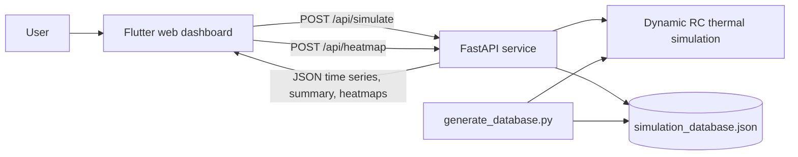

# Application documentation

## Purpose

The Paris Summer Comfort Simulation is a local web application for exploring
how envelope performance, glazing area, solar shading, and natural
ventilation affect a dwelling's energy demand and summer thermal comfort in
synthetic Paris 2050 and 2090 climates. It is a comparative design tool, not a
replacement for a validated whole-building energy model.

## Architecture



### Frontend

`frontend/frontend/lib/main.dart` contains the entire user interface, a
two-column Flutter Material dashboard:

- The left panel exposes the design parameters: wall R-value, total window
  area (split equally over the four facades), south overhang depth, night
  ventilation rate (ACH), external east/west shading, and the weather case.
- An **Air Conditioning** switch selects the view. ON (energy view): ideal
  cooling holds 26 °C, and the results show cooling and heating demand, hours
  above 26 °C and peak operative temperature. OFF (comfort view): the same
  house without cooling, showing hours above 26 °C and 28 °C, peak operative
  temperature and heating demand.
- **Run Simulation** sends the parameters to `/api/simulate`, which returns
  both runs; the switch only changes what is displayed.
- The heatmap shows, over any two parameters, cooling or heating demand (AC on)
  or overheating hours above 28 / 26 °C (AC off). Moving a slider of an axis parameter only moves the
  cursor; other changes reload the map once the slider stops moving.

The HTTP base URL is hard-coded as `http://127.0.0.1:8000`, so the dashboard is
intended for local use (directly or with Docker).

### Backend API

`backend/main.py` exposes:

| Method | Path | Function |
|---|---|---|
| `GET` | `/health` | Returns `{"status":"ok"}`. |
| `POST` | `/api/simulate` | Runs one annual simulation (with air conditioning, then without). |
| `POST` | `/api/heatmap` | Returns 30×30 maps interpolated from the precomputed database. |

`/api/simulate` request body (all fields optional):

```json
{
  "wall_r": 4.0,
  "global_window_area": 15.0,
  "overhang_depth": 0.8,
  "vent_max_ach": 12.0,
  "external_shading_enabled": false,
  "weather_case": "Paris_2090_heatwave"
}
```

`weather_case` is one of `Paris_2050_typical`, `Paris_2050_heatwave`,
`Paris_2090_typical`, `Paris_2090_heatwave`. An unknown case or a window area
that does not fit in the facades returns HTTP 400.

The response contains hourly arrays (`t_out`, `t_air`, `t_op`, `q_cool`,
`ach_vent`) and a `summary` with `total_cooling_kwh`, `total_heating_kwh`,
`hours_above_26`, `hours_above_28`, `peak_t_op` (air-conditioned run) and
`ff_hours_above_26`, `ff_hours_above_28`, `ff_peak_t_op` (free-running run).

`/api/heatmap` takes the same parameters plus `x_axis` and `y_axis` (any two of
`wallR`, `globalWindowArea`, `overhang`, `ventilation`) and returns the
`cooling`, `heating`, `overheating` (hours > 28 °C without AC) and
`overheating26` (hours > 26 °C without AC) matrices with global colour-scale
`bounds`.

## What happens when a simulation runs

1. The API loads the EPW weather file once and keeps it in memory.
2. `build_case()` in `backend/building_sim.py` creates the 100 m² one-storey
   house of `example_house()` and applies the dashboard values. The opaque
   area of each wall is reduced by its window area, so the gross facade stays
   constant.
3. `simulate()` advances through 8,760 weather hours with six implicit
   10-minute steps per hour, once with ideal cooling and once without.
4. The API serializes the results to JSON.

## Precomputed database and grid

`backend/app_grid.py` defines the heatmap grid: 9 values per parameter (wall R
spaced geometrically, ventilation denser at low rates where its effect is
strongest), 2 shading states, 4 weather cases, i.e. 52,488 grid points.
`backend/generate_database.py` simulates every point, in parallel and
resumably, and writes `backend/simulation_database.json`. The API interpolates
it multilinearly; off-grid values are within about 1 % of a direct simulation
on average.

## Thermal model

`backend/building_sim.py` implements a single-zone RC network:

- Air and internal-mass nodes represent the zone.
- Each opaque surface has two thermal mass nodes, giving a 3R2C-style envelope
  treatment with indoor and outdoor film resistances.
- Opaque surfaces use sol-air temperature, combining incident solar radiation
  and a simplified long-wave sky-loss correction.
- Windows receive direct, diffuse, and ground-reflected solar gains. A
  profile-angle calculation shades direct beam radiation when a window has an
  overhang.
- When enabled, external shades on the east- and west-facing windows (within
  45° of due east or west) deploy whenever
  the simulated zone-air temperature is above 24 °C. They reduce all solar
  gain components through those windows by 80%; the shade condition is
  reassessed at every 10-minute integration step.
- Infiltration combines a constant ACH and a wind term. Mechanical ventilation
  is optional and includes fan energy.
- Natural ventilation opens when indoor air is near the cooling setpoint and
  outdoor air is sufficiently cooler; stack and wind flow are capped at
  `vent_max_ach`. In the app, the openable area is sized from the slider value
  (`vent_area_for_ach`) so that this rate is actually reached with a 3 K
  indoor-outdoor difference and no wind.
- Scheduled people and equipment gains differ for weekdays and weekends.
- Ideal heating and cooling hold their setpoints subject to capacity limits.
  The default house has heating limited to 6 kW and cooling to 5 kW.

The linear system is solved with a matrix inverted once per simulation and a
Sherman-Morrison update for the varying ventilation term; the solar
calculations are vectorised over the year. A full year takes about 1 s.

Operative temperature is calculated as the average of zone-air temperature and
an area-weighted mean-radiant-temperature approximation. Results should be
read as model outputs based on these assumptions, especially for extreme
weather and natural-ventilation behaviour.

## Weather data

The checked-in EPW files in `backend/weather/` are synthetic Paris-Orly future
years. `backend/weather_gen.py` creates 2050 or 2090 SSP2-4.5 weather files by
starting from a synthetic baseline calibrated to approximate 1991–2020
climatology, applying monthly temperature deltas, and injecting specified heat
wave episodes. It can instead morph a supplied EPW input with
`--from-epw <path>`.

Run it from `backend/` to regenerate its local weather assets:

```powershell
Set-Location backend
python weather_gen.py --year 2090
```

## Running and developing

```powershell
# Terminal 1: API
Set-Location backend
python -m venv venv
.\venv\Scripts\Activate.ps1
pip install -r requirements.txt
uvicorn main:app --reload --port 8000

# Terminal 2: web UI
Set-Location frontend\frontend
flutter pub get
flutter run -d chrome
```

Or run both with Docker from the repository root: `docker compose up --build`.

## Offline scenario utilities and outputs

- `run_simulation.py` and `run_scenarios.py` (repository root) run the demo
  house and a 150 m² 1980s house with a deep retrofit, and write CSV, Markdown
  and PNG results to `results/`. `results_2050/` holds earlier outputs. These
  files are not read by the dashboard.
- `verify.py` runs physics sanity checks of the engine. It runs on GitHub
  Actions for every push and pull request.

## Current limitations

- The frontend's API URL is hard-coded to `127.0.0.1:8000`.
- Operative temperature uses an area-weighted mean radiant temperature that
  does not include window surface temperatures, which slightly underestimates
  it during strong solar gains.
- The model has no user accounts, persistence, or saved scenarios.
